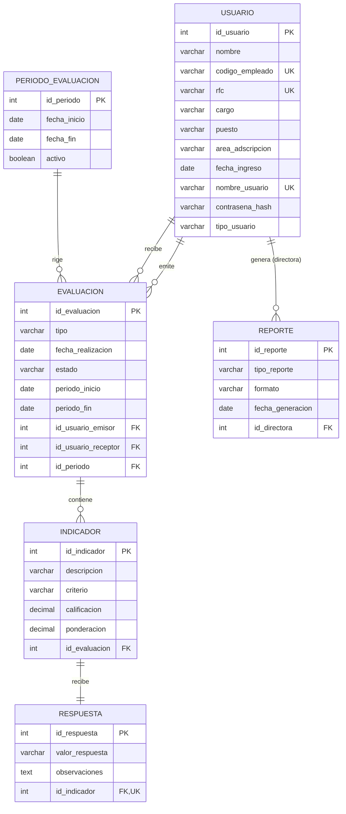

# Esquema de Base de Datos

A partir del diagrama de clases final, se diseñó el esquema de la base de datos del sistema. Cada clase se representó mediante una tabla y cada uno de sus atributos mediante una columna, con la siguiente equivalencia de tipos: `int` a `INT`, `String` a `VARCHAR`, `Date` a `DATE`, `boolean` a `BOOLEAN` y `double` a `DECIMAL(5,2)`. Las asociaciones entre clases se implementaron mediante llaves foráneas, indicadas con (FK) en la tabla siguiente.

| Clase | Atributos de la clase | Tabla | Columnas |
| :--- | :--- | :--- | :--- |
| Usuario (Administrador, DirectoraAdministracion y ServidorPublico) | idUsuario, nombre, codigoEmpleado, rfc, cargo, puesto, areaAdscripcion, fechaIngreso, nombreUsuario, contrasena, tipoUsuario | `usuario` | `id_usuario`, `nombre`, `codigo_empleado`, `rfc`, `cargo`, `puesto`, `area_adscripcion`, `fecha_ingreso`, `nombre_usuario`, `contrasena_hash`, `tipo_usuario` |
| PeriodoEvaluacion | idPeriodo, fechaInicio, fechaFin, activo | `periodo_evaluacion` | `id_periodo`, `fecha_inicio`, `fecha_fin`, `activo` |
| Evaluacion | idEvaluacion, tipo, fechaRealizacion, estado, periodoInicio, periodoFin | `evaluacion` | `id_evaluacion`, `tipo`, `fecha_realizacion`, `estado`, `periodo_inicio`, `periodo_fin`, `id_usuario_emisor` (FK), `id_usuario_receptor` (FK), `id_periodo` (FK) |
| Indicador | idIndicador, descripcion, criterio, calificacion, ponderacion | `indicador` | `id_indicador`, `descripcion`, `criterio`, `calificacion`, `ponderacion`, `id_evaluacion` (FK) |
| Respuesta | idRespuesta, valorRespuesta, observaciones | `respuesta` | `id_respuesta`, `valor_respuesta`, `observaciones`, `id_indicador` (FK) |
| Reporte | idReporte, tipoReporte, formato, fechaGeneracion | `reporte` | `id_reporte`, `tipo_reporte`, `formato`, `fecha_generacion`, `id_directora` (FK) |

El diagrama entidad–relación resultante es el siguiente:



A partir del diagrama anterior se obtiene el siguiente esquema relacional, en el que se indican las llaves primarias (PK), las llaves foráneas (FK) con la tabla a la que hacen referencia y los atributos únicos (UK):

```
usuario(id_usuario, nombre, codigo_empleado, rfc, cargo, puesto, area_adscripcion,
        fecha_ingreso, nombre_usuario, contrasena_hash, tipo_usuario)
    PK: id_usuario
    UK: codigo_empleado, rfc, nombre_usuario

periodo_evaluacion(id_periodo, fecha_inicio, fecha_fin, activo)
    PK: id_periodo

evaluacion(id_evaluacion, tipo, fecha_realizacion, estado, periodo_inicio, periodo_fin,
           id_usuario_emisor, id_usuario_receptor, id_periodo)
    PK: id_evaluacion
    FK: id_usuario_emisor   -> usuario(id_usuario)
        id_usuario_receptor -> usuario(id_usuario)
        id_periodo          -> periodo_evaluacion(id_periodo)

indicador(id_indicador, descripcion, criterio, calificacion, ponderacion, id_evaluacion)
    PK: id_indicador
    FK: id_evaluacion -> evaluacion(id_evaluacion)

respuesta(id_respuesta, valor_respuesta, observaciones, id_indicador)
    PK: id_respuesta
    FK: id_indicador -> indicador(id_indicador)
    UK: id_indicador

reporte(id_reporte, tipo_reporte, formato, fecha_generacion, id_directora)
    PK: id_reporte
    FK: id_directora -> usuario(id_usuario)
```

Para la correcta interpretación del esquema se precisa lo siguiente:

- Las clases Administrador, DirectoraAdministracion y ServidorPublico no definen atributos propios, por lo que comparten la tabla `usuario`. La columna `tipo_usuario` las distingue y solo admite `administrador`, `directora_administracion` y `servidor_publico`.
- La tabla `evaluacion` se relaciona dos veces con `usuario` (emisor y receptor), que pueden coincidir en el caso de la autoevaluación.
- Al eliminar una evaluación se eliminan sus indicadores y las respuestas de estos (`ON DELETE CASCADE`).
- El atributo `contrasena` se almacena como `contrasena_hash`, es decir, cifrada y no en texto plano.
- La columna `estado` solo admite los valores `borrador` y `enviada`.

El script SQL que crea la base de datos y sus tablas se encuentra en el archivo [`Esquema-de-BD.sql`](Esquema-de-BD.sql).