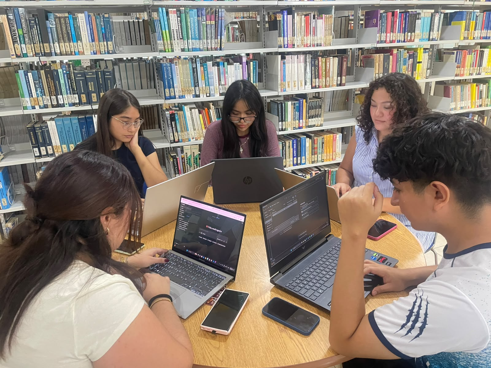

# Bitácora de Reuniones - Sprint 1 (Tercera Entrega)

**Proyecto:** Sistema de Evaluación del Desempeño de la Fiscalía General del Estado de Yucatán (SEDFGEY)  
**Periodo del Sprint 1:** Lunes 2 – Sábado 7 de noviembre (Planeación y artefactos)  
**Fecha de reunión:** Martes 3 de noviembre  

---

## 1. Resumen de la Reunión y Retrospectiva

El equipo se reunió el día **martes 3 de noviembre** con el objetivo de dar inicio formal a las actividades correspondientes a la Tercera Entrega del proyecto. 

Durante la sesión, se realizó una retrospectiva sincera sobre el desempeño en la **Segunda Entrega**, reconociendo que fue una etapa complicada debido a diversos contratiempos y errores de coordinación interna. A raíz de este análisis, el equipo se organizó para optimizar la comunicación y el seguimiento de las tareas.

Bajo esta nueva organización, se estructuró un plan de trabajo detallado dividido en 4 Sprints semanales, asignando responsables, indicadores de evaluación y puntajes claros para asegurar el cumplimiento en tiempo y forma de todos los artefactos y el código del sistema.

---

## 2. Planificación de Sprints y Asignación de Tareas

A continuación, se detalla la organización acordada para toda la Tercera Entrega:

### Sprint 1: Lunes 2 – Sábado 7 de noviembre (Planeación y artefactos)
| No. | Tarea | Indicador | Pts | Responsable |
| :---: | :--- | :--- | :---: | :--- |
| 1 | Planeación de sprints, roles y actividades | Descripción del Proceso | 1 | Dana O. |
| 2 | Crear el branch de la 3ª entrega y organizar el repositorio | Organización del Repositorio | 1 | Alejandra A. |
| 3 | Conjunto final de requisitos (RF/RNF) priorizado | Evolución de Requisitos | 2 | Rashid M. |
| 4 | Historias de usuario finales con criterios de aceptación | Refinamiento de Artefactos | 3 | Naomy A., Andrea |
| 5 | Diagrama de casos de uso final | Refinamiento de Artefactos | 2 | Dana O. |
| 6 | Diagrama de clases, versión final | Proceso de Abstracción | 3 | Valentina A. |
| 7 | Esquema de la base de datos | Uso de MVC | 2 | Alejandra A. |
| 8 | Bitácora de reuniones del sprint 1 | Gestión del Proceso | 1 | Rashid M. |

### Sprint 2: Lunes 9 – Sábado 14 de noviembre (Implementación)
| No. | Tarea | Indicador | Pts | Responsable |
| :---: | :--- | :--- | :---: | :--- |
| 9 | Implementar el Modelo (clases) | Uso de MVC | 3 | Naomy A. |
| 10 | Implementar acceso a datos y conexión con la BD | Uso de MVC | 3 | Dana O. |
| 11 | Implementar los Controladores | Uso de MVC | 3 | Andrea |
| 12 | Implementar las Vistas | Uso de MVC | 3 | Valentina A., Alejandra A. |
| 13 | Tabla de trazabilidad requisitos-clases-código | Verificación de RF/RNF | 2 | Rashid M. |
| 14 | Bitácora de reuniones del sprint 2 | Gestión del Proceso | 1 | Rashid M. |

### Sprint 3: Lunes 16 – Sábado 21 de noviembre (Integración y verificación)
| No. | Tarea | Indicador | Pts | Responsable |
| :---: | :--- | :--- | :---: | :--- |
| 15 | Integración de Modelo, Vista, Controlador y BD | Uso de MVC | 3 | Naomy A. |
| 16 | Plan de verificación de RF/RNF (método) | Verificación de RF/RNF | 2 | Andrea |
| 17 | Ejecución de pruebas y evidencias | Verificación de RF/RNF | 3 | Dana O. |
| 18 | Corrección de errores | Uso de MVC | 3 | Alejandra A. |
| 19 | Resumen de evolución del producto (1ª, 2ª y 3ª entrega) | Evolución del Producto | 2 | Valentina A. |
| 20 | Documento de cambios del diagrama de clases | Proceso de Abstracción | 1 | Valentina A. |
| 21 | Tabla de contribución individual del proyecto completo | Métrica de Contribución | 1 | Rashid M. |
| 22 | README y documentación del repositorio | Organización del Repositorio | 2 | Rashid M. |
| 23 | Bitácora de reuniones del sprint 3 | Gestión del Proceso | 1 | Andrea |

### Sprint 4: Lunes 23 – Sábado 28 de noviembre (Cierre y presentación)
| No. | Tarea | Indicador | Pts | Responsable |
| :---: | :--- | :--- | :---: | :--- |
| 24 | Competencias genéricas y específicas | Competencias | 2 | Andrea |
| 25 | Áreas de mejora (crítica constructiva al curso) | Áreas de Mejora | 2 | Valentina A. |
| 26 | Guion de la presentación en inglés (10 min) | Uso del Lenguaje y Ritmo | 3 | Alejandra A. |
| 27 | Diapositivas de la presentación | Formato de la Presentación | 3 | Rashid M. |
| 28 | Demo de la versión final | Formato de la Presentación | 3 | Naomy A. |
| 29 | Grabación, ensayo y edición | Ritmo y Formato | 3 | Dana O. |
| 30 | Revisión final de la rúbrica y URLs de evidencia | Todos | 1 | Valentina A. |
| 31 | Bitácora de reuniones del sprint 4 | Gestión del Proceso | 1 | Andrea |

---

## 3. Evidencia de la Reunión

---

## 4. Expectativas para el Siguiente Sprint

Para el **Sprint 2** (enfocado en la fase de implementación), el equipo espera encontrarse **completamente adaptado** a esta nueva estructura de organización. Con los roles claros, los artefactos base refinados y el flujo de trabajo en GitHub definido, proyectamos mantener una comunicación fluida y evitar los contratiempos presentados en la entrega anterior.